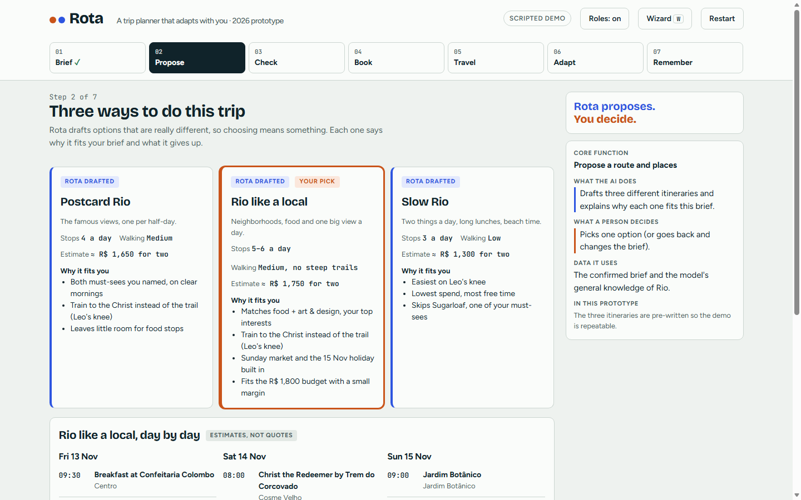
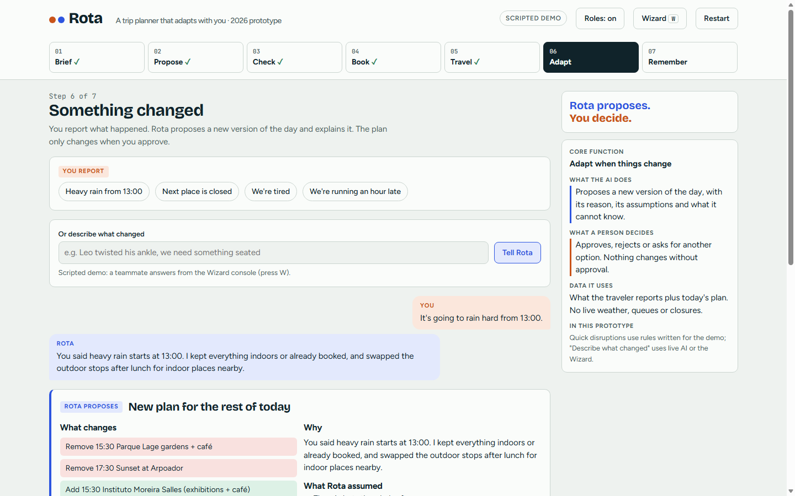

# Rota: a trip planner that adapts with you

**[▶ Try the live demo](https://l44k.github.io/rota-trip-planner/)**

Rota is a clickable prototype of an AI trip planner. The traveler describes the trip, the AI drafts three different itineraries, flags every assumption it made, prepares the bookings and, during the trip, proposes a new plan when something changes: rain, a closed museum, tired legs. The guiding rule is **Rota proposes, you decide**: nothing in the plan changes without the traveler's approval.

Made for the course DSG1957 at PUC-Rio (Rio de Janeiro), where the assignment was to imagine an AI service for the year 2050, trace it back to 2000 and then rebuild it with what AI can really do in 2026. The demo trip is a long weekend in Rio.

## The seven steps

| Step | What the AI does | What the traveler decides |
| --- | --- | --- |
| 1. Brief | Asks follow-up questions and summarises the brief | Answers, corrects and confirms the brief |
| 2. Propose | Drafts three different itineraries and explains each one | Picks one, or changes the brief |
| 3. Check | Lists every assumption (opening hours, prices) and how sure it is | Verifies the flagged items on official sites |
| 4. Book | Builds a booking checklist, drafts reservation messages in Portuguese and a calendar file | Books and pays on the official sites |
| 5. Travel | Shows today's plan and what is next | Follows the plan or reports a change |
| 6. Adapt | Proposes a new version of the day, with its reasons and what it cannot know | Approves, rejects or asks for another option |
| 7. Remember | Turns the traveler's notes into a short trip story | Chooses what to keep and share |

A "behind the scenes" panel next to each step names the core function, who does what, and which data the AI uses.

## How the demo works

- **Scripted demo:** the itineraries and most AI replies are pre-written, so the demo is repeatable in a presentation.
- **Wizard of Oz console:** press `W` to open a console where a teammate can type Rota's replies live. They appear in the traveler's view as if the AI wrote them.
- **Live AI:** when the page runs as a Claude artifact, a "Use live AI" button lets a real model answer the free-text messages. On GitHub Pages the page runs in scripted mode.

The whole prototype is one HTML file with no build step and no dependencies apart from Google Fonts.

## Built with AI

The prototype was built almost entirely with AI (Claude), on purpose: the course is about AI, and the brief asked what AI can really do in 2026. My part was the service concept, the seven-step journey and the rule that the AI proposes and the person decides, along with directing and testing the build.

## License

[MIT](LICENSE)
